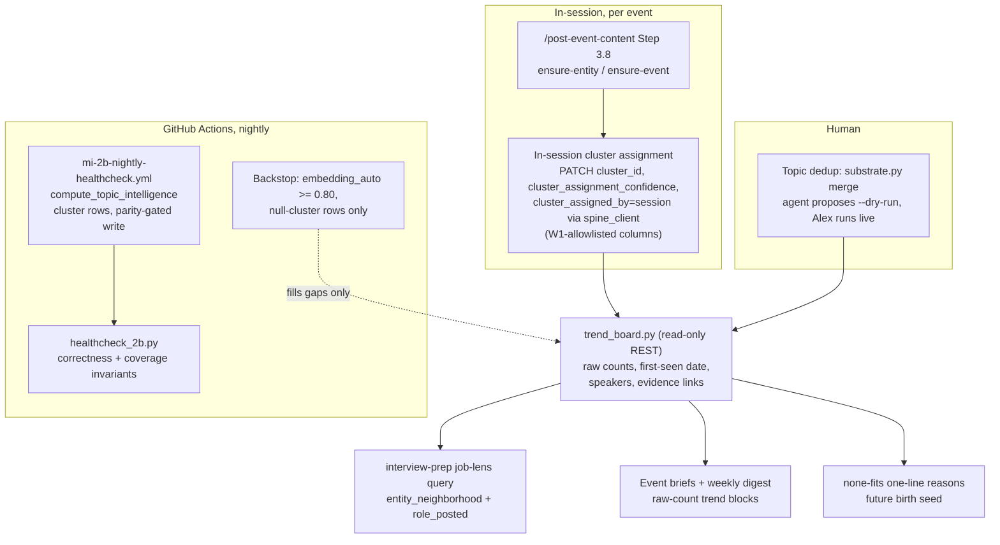

# Dynamic Trend-Evolution Layer — design proposal (V1, post-review)

**For:** Alex · **Date:** 2026-11-03 · **Revised:** 2026-11-04 to the V1 scope all three PR #264 reviews converged on (author response: the reconciliation of record)
**Evidence base:** repo files cited inline (read from `main`, post-W1 #265 and post-W2 #266 merges); YED-304 (`docs/proposals/2026-11-03-topic-clustering-gap.md`, prod reads 2026-11-03); S-01/S-03 specs in `docs/specs/`; the three PR #264 review comments and the author response. No Supabase data was touched — schema knowledge comes from repo code and the spec only.
**Scope of this revision:** docs-only. Phases 1–3 as originally written are NO-GO — every deferred mechanism now sits in a table with an explicit trigger (§8). Nothing here is built.

## The short version

The trend layer today reports movement per fixed theme and only counts attended-event tags: 30 curated clusters, assigned once in July/August, nothing assigning since (YED-304 §1). The reviews killed the original plan's centerpiece: W2's embedding review queue cannot seed births (it auto-assigns ~3% of the backlog — a birth detector fed from that queue groups noise, not themes), and statistics at ~3 attended events/week produce roughly as many false movers as real ones. The V1 scope that survived all three reviews is small, gated, and zero-DDL:

1. **Topic dedup** — the cheapest fix for the evidence-volume problem: a per-topic board splits a real 3-event trend across three duplicate topics and turns it into three 1-event non-trends. `substrate.py merge` is human-only and reversible.
2. **In-session cluster assignment** — the session that mints a topic (Step 3.8) holds the transcript, the brief and the roster; it assigns the cluster. Nightly assignment is demoted to a backstop.
3. **The job-lens trend query** — "who is building and hiring around X" ties straight to the 2026 goal, is a query over existing tables, and has no taxonomy dependency.
4. **A read-only trend board** — raw counts, first-seen dates, speakers, evidence links. No z-scores.

Everything else — emergence machinery, derived macro families, velocity statistics, LLM summaries, cross-entity snapshots — is deferred with a written trigger, not a vague "later." **One hard ordering constraint binds all of it: dedup completes before anything is persisted** (§8).

**Load-bearing assumption.** This design assumes the graph's evidence volume is enough for trend signals to be actionable rather than noise. The pipeline sees roughly 3 attended events a week spread across 30 themes, and `granularity_insufficient` already trips at 1.000 against a 0.400 threshold (YED-304 §2, §4.4). The reviews' answer if the tripwire does not clear after the W2 backfill: **add a 90-day window and point the tripwire at it — change the window, not the meaning of a trend.** Re-measure after the backfill before anything deferred is built.

## Blockers — three product questions for Alex

Nothing beyond Phase 0's four items is built until these are answered. They are product calls, not technical ones.

1. **What unit do you reason with in prep:** specific topics with counts, speakers and first-seen dates, or broad "heating" themes? (The V1 board ships the former; the latter is the deferred statistics machinery.)
2. **Should trends cover only your rooms, or the market too?** (V1 default: attended-only. A market lens, if wanted, is separate labelled rows — see deferred table.)
3. **Will you review a taxonomy queue for ~5 minutes each Monday?** The in-session assignment change shrinks this question's scope: assignment rides the existing Notion review, so the Monday queue applies only to future merge/split gating — if that ever earns its trigger. If the answer is no, gated emergence has no gatekeeper and should not be built.

## 1. What the graph holds today

**Entities and edges.** Four first-class objects plus one hyperedge: `company`, `person`, `topic`, `event` (a temporal hyperedge that is also the signal model), and `event_entity` — the polymorphic join `(event_id, entity_type ∈ {company,person,topic}, entity_id, role)` (`.claude/references/market-intel-spine.md`). Event `kind` splits into attended / market / funding / launch / exec_move, plus the job-lens lifecycle role_posted / application / interview, which is deliberately isolated from other lenses (YED-149; `entity_neighborhood`, migration 0011). The claim layer (ADR-10, migration 0009) adds `claim`, `claim_entity`, `claim_relation`, `document_entity`, `documents`/`doc_chunks` — claims carry embeddings, `asserted_at`, `status`, `provenance_tier` (allowlist: `.claude/scripts/spine_client.py` lines 61–84). Every entity also carries `relevance_score`, `last_engaged_at`, `engagement_count`, refreshed nightly at 07:00 UTC by `relevance-recompute.yml` (14-day half-life, 30-day upcoming-event proximity — `recompute_relevance.py` lines 33–34).

**Trend compute, as it exists.** `topic_intelligence.compute_topic_intelligence` (migration 0012) rebuilds two tables per night over 30/7/all-time windows: `topic_trend` (event counts, distinct speaker counts, momentum `(ec−pc)/max(pc,1)`, labels `insufficient_data / new / heating / cooling / steady`) and `topic_pair_metric` (co-occurrence, speaker bridges across ≥2 distinct events, `intersection_score`). Both tables are scoped to `kind='attended'` + `role='tagged_topic'` and filtered to `t.cluster_id is not null` — which is exactly where the unassigned topics vanish. One schema detail matters enormously: `topic_trend.subject_level` is `check (subject_level in ('topic','cluster'))` (migration 0001, line 156) — the table was built anticipating topic-level rows, but V1 only ever populates cluster rows (migration 0002, line 98). Topic-level trending needs no new columns.

**The curated cluster taxonomy — stated honestly.** 30 clusters, per YED-304's prod read of 2026-11-03. The count is a measurement, not code: the bootstrap script that produced them (`bootstrap_clusters.py`, YED-110) lives in the gtm-os repo, not here, and this repo contains no seed insert — `build_2b_canonical_v2.py` only carries existing rows forward (line 178). What this repo does hold is the cluster *schema*: `topic_cluster` with `parent_cluster_id` (self-FK), `curation_status in ('proposed','approved','deprecated')`, `curated_by` (migration 0001, lines 85–105). Those lifecycle states exist in the database and are unused as a process — the bootstrap wrote its rows once and stopped.

**The signal stock.** As of 2026-10-30 (S-01's live read): 4,543 claims with 674 added in the prior 7 days, all embedded; 1,004 claims (22%) linked to no entity; `claim_usage` and `artifact_outcome` at 0 rows; only 20 of 266 topics had a relevance score. The claim layer is rich but under-linked — that shapes what trend signals can honestly use today (§5, and open question 5).

## 2. How the taxonomy evolves: in-session births, human-run merges

The design rule, inherited from YED-304 §6: **the system proposes, Alex decides.** No nightly job ever writes a cluster change on its own authority.

**Births — assigned in the session that mints the topic.** The original design seeded every birth proposal from W2's embedding review queue. That foundation is empirically dead: in the #266 study, name-only kNN auto-assigns about 3% of the real 94-topic backlog (ship-point coverage 5.9%), so roughly 97% of new topics would land in "none fits" and the birth detector would be grouping noise. The replacement, converged on by all three reviews: **assign at the moment of creation, by the session that created the topic.** At `/post-event-content` Step 3.8, after `ensure-entity`/`ensure-event` creates the topic rows, the session — which already holds the transcript, the Step 3.6 enrichment + Speaker Map, the Step 3.7 brief, and the roster with stable Notion page IDs (far richer context than a bare topic name) — PATCHes `cluster_id`, `cluster_assignment_confidence` and `cluster_assigned_by='session'` through `spine_client`: exactly the three columns W1 allowlisted in #265, negative-PII selftests included. No new guard surface, no migration, no grant change. The cluster list it needs is one REST GET of `topic_cluster`. A topic that fits nothing gets **"none fits" with a one-line reason** — and those one-line reasons are the future birth seed: YED-304 §6's rule stands (three or more coherent "none fits" propose a new theme), filed to Linear when it fires. It costs nothing on the subscription, and it is covered by Alex's existing Notion review.

**Known gap, acceptable and visible.** Steps 3.8b/c are mandatory-but-not-enforced (a skipped graph write closes green — the command file says so at line 229); in-session assignment inherits that. This is exactly why the nightly stays as a **backstop**: `embedding_auto` at ≥ 0.80, null-cluster rows only. Recommended wiring: the Step 6 summary reports assignment status beside the 3.8b/c status line so the gap stays visible. **W2's status is unchanged by any of this:** merged (`2e840d4`, PR #266), it is a *measured baseline* — k=3/0.85 precision 0.900 (9/10), Wilson lower bound 0.596, 5.9% coverage — with **no production role**. It does not feed the birth queue and does not assign; the nightly backstop is the only residual consumer of its approach.

**The backlog pass.** The same in-session pattern over the 94 real topics (excluding tombstones), one review table for Alex. This also unblocks GLM-5.3, which waits on clustering for its 2 topics.

**Topic dedup — the merge that matters now.** S-03 found near-duplicate topics; "GTM Engineering" alone exists three times. A per-topic board splits each real trend's count across its duplicates, turning a 3-event trend into three 1-event non-trends. Topic canonicalization is the existing, reversible, human-only fix: `substrate.py merge --table topic --from <id|name> --into <id|name> --reason "…" [--dry-run]` — the agent proposes with `--dry-run`, Alex runs the live one. It tombstones the source (`metadata.merged_into` + an edge snapshot, `--revert` restores), re-points `event_entity` edges, and deletes nothing; the identity resolver follows tombstones fail-loud (a dangling `merged_into` raises rather than guesses). It never touches the cluster columns, so no W1 interaction. **But it is not history-free:** re-pointing edges moves counts between clusters when duplicates span clusters — the same class of break as a cluster merge. That is the hard ordering constraint in §8.

**Cluster-level merges, splits, decay — deferred.** The original §2 machinery (centroid-drift merge detection, embedding-spread splits, 90-day decay proposals) is deferred with an explicit trigger in §8. At ~13 attended events/month across 30 clusters, many clusters go 90 days without a tagged event by chance — a decay rule would propose retiring live themes. Every proposal, of every kind, remains one decision for Alex, batched in one review pass.

## 3. Macro and micro: CUT

Option 2 of the original section — **derived macro families** computed nightly from `topic_pair_metric` and co-occurrence, shown after a 2-run hysteresis and LLM-named — is **CUT**. Both reviews converged on why: it is the only ungated change to the taxonomy in the original plan. It moves with no decision record, and its labels wobble as the data shifts. Nothing in V1 derives macro structure.

One idea survives, moved to the deferred table: hand-curated cluster families via the existing `parent_cluster_id` column — but only as a *cached human decision* (a family blessed by Alex after it has held stable), never as a computed output. It earns nothing until the gated machinery does (§8).

Micro = individual topic, which the schema already supports (`subject_level='topic'` is a legal value in `topic_trend`, migration 0001 line 156); V1's board reads topic rows directly, no hierarchy needed.

## 4. Trend signal: raw counts first, velocity deferred

**What the board shows in V1 — evidence rows only.** Per topic and per cluster: attended events tagged with the topic (via `event_entity`), **raw counts**, **first-seen date**, **distinct speakers**, and **evidence links** to the events. Job-lens events (`role_posted` etc.) never enter the trend math — kind isolation is invariant (YED-149, migration 0011); they surface only in the job-lens view (§6). Claim volume starts as a non-signal: with 22% of claims entity-unlinked (S-01), claims appear as evidence links only (open question 5).

**No z-scores, no shrinkage, no velocity in V1.** The original design's Poisson z-score against a decayed baseline fails on arithmetic the reviews surfaced: 272 topics tested weekly at a z > 2 bar yields about 6 false "heating" topics a week under the null — roughly as many as the real movers. There is no data to tune the shrinkage `k`, and event count (~3 attended/week) is the binding limit, not the number of clusters. If the signals ever return, **k is measured, not chosen**: the smallest k at which the permutation-shuffled board (shuffle event dates 200×) yields at most one `heating` topic per week; prior 3. Trigger in §8.

**Where it runs.** Client-side in a read-only script (§8, Phase 0 item 4): REST GETs only, stdlib-only like its siblings. 272 topics is trivial arithmetic. Nothing persists, so nothing needs the parity gate.

## 5. "Why is this trending": the template's evidence is the summary

V1 has no LLM summaries. The template "why" — counts, speakers, first-seen dates, clickable evidence links — covers the need (~80%, per review); a summary written from those rows adds polish, not information. Deferred with a concrete trigger: summaries return only if the template version **loses a blind test** against a summary version — not before. If ever added, they run in the subscription session, not as a nightly paid API call (`OPENAI_API_KEY` spend is Alex's call, and the reviews flagged §5's original model choice as new spend). Claim text stays evidence-linked only while 22% of claims sit unlinked against S-01's 5% target.

## 6. Consumption surfaces — v1 of each

**Job-hunt prep — build this first.** The reviews rated it the highest-value item in the doc: *who is building and hiring around trend X?* ties straight to the 2026 goal, an offer. The join is: topics → tagged attended events → attending people (speakers) and companies → `role_posted` events for those companies, using `entity_neighborhood`'s per-seed-company hiring counts. Two prerequisites the reviews added: (a) **verify `entity_neighborhood`'s live column shape (migration 0011) as the task's first step** — the spec's description is not a prod read; (b) it needs its own **topic-selection input** (manually named topics, or all tagged topics) — "per selected trend" presumes the board exists, and the query ships before it. V1: a section in `interview-prep-dossier` (E-09) — the dossier already exists; the trend block is a query, not a new skill.

**Event briefs.** `/event-deep-research` already wires `retrieve.py --lens event` into Step 1.7a (S-01, YED-261). V1: append a raw-count trend block to the brief template — the topics moving in this event's clusters, each with counts, speakers and evidence links. Template-plus-query; no new skill.

**Weekly digest.** V1: the Monday read is the board plus the week's in-session "none fits" one-line reasons — one artifact that is simultaneously the trend product and the seed file for future birth proposals. No summaries, no deltas.

**Content ideation.** Rising topics by raw count within the window, from the same board. No velocity labels in V1.

## 7. Architecture

Solid arrows are reads or session writes; dashed is the backstop fill. The nightly compute and health-check are unchanged — V1 adds no step to any workflow.

## 8. Roadmap: Phase 0 is the plan of record

**Hard ordering constraint — read before building anything that persists.** Topic dedup must complete before any surface stores trend history. `substrate.py merge` re-points `event_entity` edges (deletes nothing; tombstones via `metadata.merged_into`), so counts move between clusters when duplicates span clusters — the same class of history break as a cluster merge. That is safe today *only* because V1 persists nothing and the nightly compute re-reads the live graph. **Once any surface stores week-over-week deltas, topic merges AND cluster merges both require effective-dated `topic_cluster_membership(topic_id, cluster_id, valid_from, valid_to)`** — with compute reading membership as of the window — or parity stays green while every historical delta on the affected rows becomes meaningless. This is a stated precondition, not an implied one.

**Phase 0 — the plan of record. Zero DDL, zero new spend, no workflow changes.**

1. **Topic dedup pass** via `substrate.py merge --table topic`: the agent proposes with `--dry-run`, Alex runs the live merges. Human-only, reversible, deletes nothing.
2. **In-session cluster assignment:** at `/post-event-content` Step 3.8 the session PATCHes `cluster_id`, `cluster_assignment_confidence`, `cluster_assigned_by='session'` through `spine_client` — the three W1-allowlisted columns (#265). The nightly assigner is demoted to backstop (`embedding_auto` ≥ 0.80, null-cluster rows only). Includes the one-time backlog pass over the 94 real topics (excluding tombstones), one review table for Alex.
3. **Job-lens trend query feeding `interview-prep`:** note its topic-selection input (manually named topics, or all tagged topics), and **verify `entity_neighborhood`'s migration-0011 column shape before building** — §6's description comes from the spec, not a prod read.
4. **Read-only `trend_board.py`** (`supabase/scripts/`): raw counts, first-seen date, speakers, evidence links. **NO z-scores.**

**Phases 1–3 as originally written: NO-GO.** The machinery is deferred, each item with its trigger:

| Deferred machinery | Built only when |
|---|---|
| Drift, split, decay and cluster-merge proposals | Effective-dated `topic_cluster_membership` exists **and** ≥5 coherent "none fits" accrue over 6 weeks |
| z-scores and shrinkage (§4 velocity) | `granularity_insufficient` < 0.400 after the W2 backfill; k measured via the permutation noise floor (prior 3), not chosen |
| LLM why-summaries (§5) | The template version loses a blind test |
| `trend_snapshot` table (original Phase 3) | A surface actually reads persisted snapshots |
| Hand-blessed macro families via `parent_cluster_id` (§3 salvage) | Same trigger as cluster merges — gated, effective-dated; never computed |
| Market lens (market/funding event kinds) | Only as separate labelled rows, if Alex wants one (product call, blocker Q2) |

## Open questions — post-review recommendations

1. **Scope widening.** **No merge of scopes.** Attended-only default. If `granularity_insufficient` stays at 1.000 after the backfill, add a 90-day window and point the tripwire at it — **change the window, not the meaning of a trend.** A market lens, if Alex wants one, is separate labelled rows. Alex's product call.
2. **Healthcheck parity.** V1 persists nothing → parity untouched. When persistence is earned: **one grain-parameterized function per side, updated in lockstep** — `healthcheck_2b.py`'s `ref_compute(as_of, ev_date, event_clusters, event_speakers)` (line ~101) is already data-shaped with no cluster logic inside (the cluster-bound parts are the loader and the `subject_level='cluster'` filter), so the same works in SQL with a `p_level` argument. Cheaper than a sibling function — but a signature change to a checked function remains a lockstep change under the parity contract: reference and caller in the same PR.
3. **The `new` label at topic level.** **Floor of 3, not 2** — matching 0012's `tw.ec < 3 → insufficient_data` (verified in `supabase/scripts/healthcheck_2b.py`'s `_label`, lines 90–92). `new` = first-ever tagged event inside the window, flagged `is_low_confidence`, capped at 5, sorted by count. No z-scores or shrinkage in V1; if they return, k is measured via the permutation noise floor (prior 3).
4. **W4's zero-tag events.** **Resolved:** 2 not-attended rows removed (attended now 84), 9 topic links written through `substrate.py`, 4 of the 5 repaired events count. GLM-5.3 waits on clustering for its 2 topics, which the in-session backlog pass resolves.
5. **Claim-link quality.** **Claims are evidence links only in V1** — not a counted signal while 22% sit unlinked against the 5% target. Gated on `resolve_claim_entities.py` at scale.
6. **Summary model and spend.** **Deferred** (§5). If ever added: run in the subscription session, not as a nightly paid API call. Alex owns spend.
7. **Proposal persistence.** **Linear, births only, for V1** — one weekly batched `decision` issue covering that week's proposals (volume is ~1/week, so per-proposal issues are noise). A `cluster_proposal` table ships **in the same migration as effective-dated `topic_cluster_membership`**, triggered by the **first approvable merge** — not a volume threshold.

---

## Data corrections from Claude Code review (2026-11-03)

The original body above is preserved as written. Claude Code's independent prod read on this branch (PR #264) corrected several of its counts:

- **(a) Unassigned backlog is 94, not 102.** 8 of the rows are merge tombstones (`metadata ? 'merged_into'`) and should be excluded from training and evaluation sets.
- **(b) Assigned topics are 170, not 145, and all carry `cluster_assigned_by='llm'`.** Any kNN validation therefore measures agreement with the original LLM bootstrap taxonomy, not hand-labelled ground truth.
- **(c) Clusters are small** — 2–10 topics each, with 8 of the 30 clusters having ≤3 members — so k=7 is biased toward large clusters. Recommend sweeping k ∈ {1, 3, 5, 7} in the W2 assigner.
- **(d) Event-kind counts:** attended 86 (84 after W4 removes the 2 not-attended rows), market 31, launch 9, funding 3, exec_move 1, role_posted 183. Widening trend scope to market+funding+launch adds only ~43 all-time events — insufficient for month windows.
- **(e) `granularity_insufficient`=1.000 is partly W4 data loss** — 9 of the 25 recent attended events counted nothing toward it.
