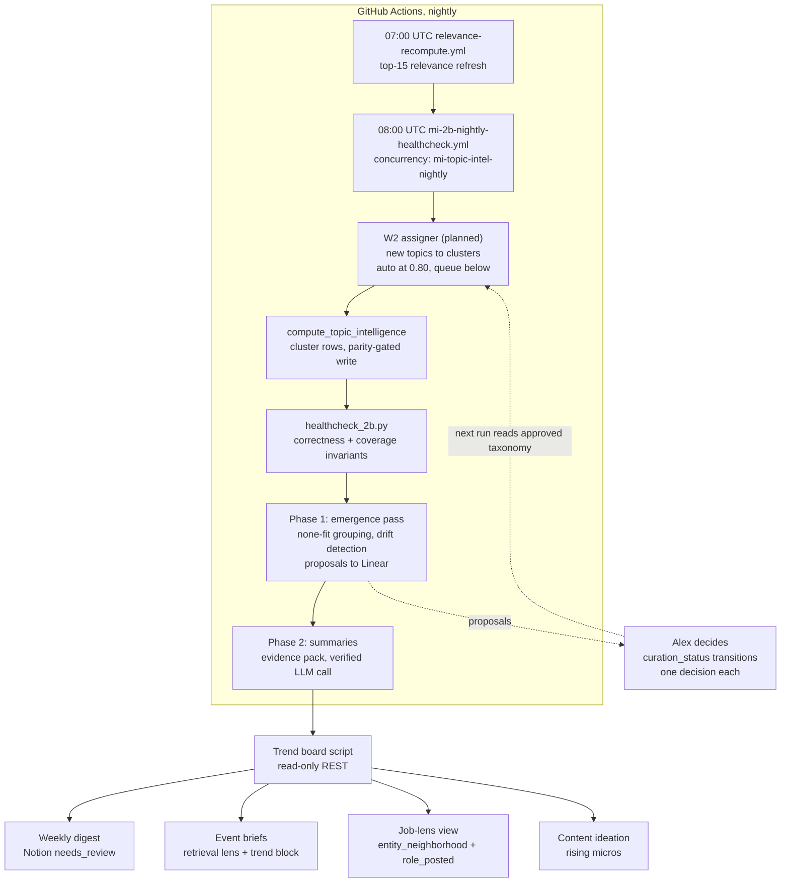

# Dynamic Trend-Evolution Layer — design proposal

**For:** Alex · **Date:** 2026-11-03 · **Task:** read-only design (no repo changes)
**Evidence base:** repo files cited inline (read from branch `yed-304-w1-topic-cluster-allowlist`, where W1's allowlist diff is present but PR #265 is still open); YED-304 (`docs/proposals/2026-11-03-topic-clustering-gap.md`, prod reads 2026-11-03); S-01/S-03 specs in `docs/specs/`. No Supabase data was touched — schema knowledge comes from repo code and the spec only.

## The short version

The trend layer today reports movement per fixed theme and only counts attended-event tags: 30 curated clusters, assigned once in July/August, nothing assigning since (YED-304 §1). W1/W2 — in flight — turn cluster assignment into a nightly process. This proposal builds the next layer on that foundation: topics trend in their own right, macro themes are *derived* from observed co-occurrence across the graph instead of curated by hand, the taxonomy proposes its own births, merges and deaths through a gated queue, and every trend ships with a grounded "why." Nothing here adds a second write path: every write rides `spine_client.py`, and any new table follows the ADR-9 migration discipline (repo migration → twin rehearsal → Alex applies).

The smallest useful increment needs zero DDL and zero guard changes: a read-only trend-board script Alex could read next Monday. The emergence machinery and cross-entity snapshots come after, each earning its spine migration only when volume justifies it.

**Load-bearing assumption.** This design assumes the graph's evidence volume is enough for trend signals to be actionable rather than noise. The pipeline sees roughly 3 attended events a week spread across 30 themes, and `granularity_insufficient` already trips at 1.000 against a 0.400 threshold (YED-304 §2, §4.4). If that tripwire does not clear after W2's backfill, the answer is not more hierarchy — it is widening the evidence base (market/funding event kinds, claim flow) or pooling windows. Re-measure after the backfill, as YED-304 §4.4 already says, before building Phases 1–3.

## 1. What the graph holds today

**Entities and edges.** Four first-class objects plus one hyperedge: `company`, `person`, `topic`, `event` (a temporal hyperedge that is also the signal model), and `event_entity` — the polymorphic join `(event_id, entity_type ∈ {company,person,topic}, entity_id, role)` (`.claude/references/market-intel-spine.md`). Event `kind` splits into attended / market / funding / launch / exec_move, plus the job-lens lifecycle role_posted / application / interview, which is deliberately isolated from other lenses (YED-149; `entity_neighborhood`, migration 0011). The claim layer (ADR-10, migration 0009) adds `claim`, `claim_entity`, `claim_relation`, `document_entity`, `documents`/`doc_chunks` — claims carry embeddings, `asserted_at`, `status`, `provenance_tier` (allowlist: `.claude/scripts/spine_client.py` lines 61–84). Every entity also carries `relevance_score`, `last_engaged_at`, `engagement_count`, refreshed nightly at 07:00 UTC by `relevance-recompute.yml` (14-day half-life, 30-day upcoming-event proximity — `recompute_relevance.py` lines 33–34).

**Trend compute, as it exists.** `topic_intelligence.compute_topic_intelligence` (migration 0012) rebuilds two tables per night over 30/7/all-time windows: `topic_trend` (event counts, distinct speaker counts, momentum `(ec−pc)/max(pc,1)`, labels `insufficient_data / new / heating / cooling / steady`) and `topic_pair_metric` (co-occurrence, speaker bridges across ≥2 distinct events, `intersection_score`). Both tables are scoped to `kind='attended'` + `role='tagged_topic'` and filtered to `t.cluster_id is not null` — which is exactly where the 102 unassigned topics vanish. One schema detail matters enormously: `topic_trend.subject_level` is `check (subject_level in ('topic','cluster'))` (migration 0001, line 156) — the table was built anticipating topic-level rows, but V1 only ever populates cluster rows (migration 0002, line 98). Topic-level trending needs no new columns.

**The curated cluster taxonomy — stated honestly.** 30 clusters, per YED-304's prod read of 2026-11-03. The count is a measurement, not code: the bootstrap script that produced them (`bootstrap_clusters.py`, YED-110) lives in the gtm-os repo, not here, and this repo contains no seed insert — `build_2b_canonical_v2.py` only carries existing rows forward (line 178). What this repo does hold is the cluster *schema*: `topic_cluster` with `parent_cluster_id` (self-FK), `curation_status in ('proposed','approved','deprecated')`, `curated_by` (migration 0001, lines 85–105). Those lifecycle states exist in the database and are unused as a process — the bootstrap wrote its rows once and stopped. Much of the dynamic layer is wiring up states that already exist.

**The signal stock.** As of 2026-10-30 (S-01's live read): 4,543 claims with 674 added in the prior 7 days, all embedded; 1,004 claims (22%) linked to no entity; `claim_usage` and `artifact_outcome` at 0 rows; only 20 of 266 topics had a relevance score. The claim layer is rich but under-linked — that shapes what trend signals can honestly use today (§5).

## 2. How the taxonomy evolves: emergence, merge, split, decay

The design rule, inherited from YED-304 §6: **the system proposes, Alex decides.** No nightly job ever writes a cluster change on its own authority.

**Births.** The seed is W2's review queue. A topic that fits no cluster at ≥ 0.80 confidence lands in the queue with a "none fits / new theme" option (YED-304 §W2). YED-304 §6 already sketches the rule — three or more coherent "none fits" propose a new theme. The dynamic layer formalizes it: each night, the none-fit topics are grouped by embedding affinity (same `bge-small` vectors, `dockb_common.py` lines 20–21; agglomerative grouping with a conservative similarity floor). A group of ≥3 none-fits with pairwise similarity above the floor becomes a *cluster birth proposal*: suggested name, the member topics, the evidence. A singleton none-fit just waits — no proposal, no noise. Proposals need somewhere to live. V1 answer: a Linear issue filed by the nightly script (Linear is the one list, and this costs zero DDL). A dedicated table only becomes worth migrating when proposal volume exceeds roughly 5 per week — nothing in the current numbers (33 attended-linked unassigned topics total, YED-304 §2) suggests it will soon.

**Merges.** Two failure modes produce merges: taxonomy drift (two themes converging on the same ground) and duplicates (S-03's finding of near-duplicate topics like "Agent Observability & Management" vs "…Monitoring", generalized to clusters). Detection is cheap and evidence-grounded: when two clusters' member-embedding centroids drift within a similarity threshold *and* `topic_pair_metric` shows them co-occurring abnormally often (they share events and bridge speakers at rates their history doesn't explain), the nightly proposes a merge with the numbers attached. On approval: the absorbed cluster's rows go `curation_status='deprecated'`, member `topic.cluster_id` re-points, and `cluster_assigned_by='human'` records Alex's hand — all sanctioned writes under the W1 allowlist (`spine_client.py` lines 55–57).

**Splits.** A cluster whose member-embedding spread keeps growing, or whose share of all-time events keeps inflating the `granularity_occupancy` catch-all tripwire (migration 0013, threshold 0.200), is a candidate. The nightly proposes a split with the candidate sub-groups (agglomerative over member embeddings); Alex names the children and picks the survivors.

**Decay.** A cluster with no tagged attended events for 90 days *and* no new topics joining proposes `deprecated`. Deprecated clusters leave the trend board but their history rows persist — trend history is never rewritten, the same DELETE-by-as_of discipline 0012 applies to snapshots.

Every proposal, of every kind, is one decision for Alex, batched in one review pass. The gate structure mirrors what already works: the review queue from W2, Notion comment review for drafts, `curation_status` as the state machine.

## 3. Macro and micro: where the hierarchy comes from

Three ways to get "macro trends vs micro topics," with the trade-offs priced:

1. **Hand-curated cluster families** via the existing `parent_cluster_id` column. Cheapest to ship, most stable labels, but it is exactly the fixed taxonomy Alex wants to evolve past — it would just add a second hand-maintained layer that also silently rots.
2. **Derived macro themes** from graph evidence: a macro is a set of clusters (and eventually topics) that reliably fire together at attended events and share bridge speakers — computable from `topic_pair_metric` plus the entity graph, named by a cheap LLM pass Alex approves once. Dynamic and evidence-grounded; the cost is label stability, since the families wobble as the data shifts.
3. **Pure embedding-space clustering** (hierarchical clustering over topic vectors). Fully automatic, but unanchored to evidence — it would group "Agent Observability" with "Evals" because the words are similar even if no event ever put them in the same room. Rejected for the same reason raw LLM assignment was rejected in YED-304: not reproducible from the curation Alex already trusts.

**Recommendation: option 2, with option 1 as its cache.** Derived families are the product; `parent_cluster_id` is where a family goes once it has held stable and Alex has blessed it — a cached human decision, not a hand-built taxonomy. Two stabilizers make this workable: hysteresis (a derived family must persist across 2+ consecutive weekly runs before the board shows it) and a minimum evidence floor (families form only over clusters with non-trivial co-occurrence in the window). Micro = individual topic, which the schema already supports (`subject_level='topic'` is a legal value in `topic_trend`, migration 0001 line 156). The macro/micro edge is then just "which derived family contained this topic this week," stored with the run so past weeks keep their own structure.

## 4. Trend signal: velocity against your own baseline

Raw counts fail small topics — "Agent Observability" appearing at 2 events means nothing by itself; the same 2 events against a history where it never appears means a lot. The signal design:

**Evidence rows.** Per trend: attended events tagged with the topic (via `event_entity`), distinct speakers, claim volume (claims linked through `claim_entity` or `document_entity`, using `claim.asserted_at`), and new entrants — people and companies whose *first* tagged event falls in the trailing 30 days at events also carrying the trend's topics. The claim contribution is honest about its weakness: with 22% of claims entity-unlinked (S-01), claim volume starts as a conservative term until `resolve_claim_entities.py` runs at scale. Job-lens events (`role_posted` etc.) never enter the market-lens math — kind isolation is invariant (YED-149, migration 0011); they surface only in the job-hunt view (§6).

**Time-decayed activity.** Exponential decay with the 14-day half-life `recompute_relevance.py` already chose (line 33) — one decay convention across the system, no new constant to explain.

**Velocity vs own baseline.** A Poisson-style z-score: `(observed − baseline) / √baseline`, where baseline is the trend's own trailing 90-day decayed-average weekly activity. This is the piece that lets a micro-topic trend: a topic with baseline 0.2 events/week hitting 2 events scores z ≈ 4, while a 30-event cluster hitting 32 scores z ≈ 0.4. Thin histories get shrunk toward zero (empirical-Bayes style, scaling the z-score by `n/(n+k)` on evidence rows) so a topic's literal first appearance can't top the board on one coincidence. Labels reuse the existing vocabulary (`new / heating / cooling / steady / insufficient_data`) so nothing downstream re-learns.

**Staleness.** A trend leaves the board when its decayed activity falls under an absolute floor and its z-score has sat near zero for 2 consecutive weeks. History rows persist; only the surface changes. The board's "fallen off" list is itself useful — knowing *when* a theme died is trend information.

**Where it runs.** Phase 0 runs it client-side in a read-only script (§7): 272 topics is trivial arithmetic over REST reads, no DDL, no writer. Once the board earns its keep, the math graduates into a *sibling* compute function (e.g. topic-level + cross-entity snapshots) alongside the existing one — deliberately not by editing 0012's function, because the nightly's parity gate (`topic_intel_compute.py --apply` must reproduce `healthcheck_2b.py`'s independent reference exactly) means touching the checked SQL touches both sides in lockstep. A new function starts clean with its own parity contract. That graduation is a spine migration: repo file → twin rehearsal on `ytfzzsxcxxbejnowmkmk` → Alex applies; `pipeline_writer` grants per the 0003 pattern.

## 5. "Why is this trending": grounded reasoning

Every board-worthy trend gets a 2–3 sentence explanation, built the way `output-evaluator` treats claims: nothing asserted that isn't in the evidence.

**Mechanism.** After the nightly compute, a script builds an evidence pack per trend that crossed the board bar: the tagged events (title, date, kind), the speakers, entity firsts ("First appearance: Company X, Event Y"), top claims with `locator` + quote, and the baseline numbers (observed vs expected, the z-score). One LLM call per trend writes the summary *from the pack only*; a deterministic verifier then re-checks that every named event/person/company/claim in the summary actually appears in the pack, and strips or fails sentences that don't. The model call is cheap by construction: the board caps at ~10 trends/night, packs are a few hundred tokens of pre-selected evidence, and the model runs on the `OPENAI_API_KEY` already listed in `.env.example` — no new vendor.

**Placement.** A new step in `mi-2b-nightly-healthcheck.yml`, after compute and health-check succeed, inside the workflow's existing concurrency group (`mi-topic-intel-nightly`) so nothing races the compute. Failure behavior reuses the rolling-issue pattern the workflow already uses (one open issue, later failures comment on it). V1 stores summaries in the digest surface (Notion `needs_review` page / GitHub issue), not the spine — no DDL for prose the board re-renders nightly anyway. If summaries later need to be queryable alongside snapshots, they move into the same Phase-3 migration.

## 6. Consumption surfaces — v1 of each

**Job-hunt prep.** Question: *who is building and hiring around trend X?* The join is: trend → topics → tagged attended events → attending people (speakers) and companies → `role_posted` events for those companies, using `entity_neighborhood`'s existing per-seed-company hiring counts (migration 0011). V1: a `--trend` mode on the read-only board script that prints, per selected trend, the companies (ranked by trend-adjacent activity + open roles), the people to know (speakers with engagement counts), and links to the evidence rows. This feeds `interview-prep-dossier` (E-09) as an input section — the dossier already exists; the trend block is a query, not a new skill.

**Content ideation.** Rising micro-trends within a macro: topic-level rows labeled `new`/`heating` whose topic joined a derived family in the last 14 days. V1: a table on the weekly digest page (Notion `needs_review`), one row per riser with its why-summary and 1–2 evidence links. The natural home for the first pilot is the Upcoming Week roundup's existing structure — one slide or one paragraph, sourced entirely from the nightly's own rows.

**Research briefs.** `/event-deep-research` already wires `retrieve.py --lens event` into Step 1.7a (S-01, YED-261). V1: append a trend block to the brief template — the trends whose velocity is elevated at this event's clusters, each with its why-summary — so Alex walks in knowing which conversations are live and which are stale. This is template-plus-query; no new skill.

**Weekly digest.** V1: the Notion `needs_review` page the summaries step already writes — board trends with week-over-week deltas, new entrants, births/merges/decays *proposals* awaiting Alex's decision, and the fallen-off list. One artifact, Monday morning, that is simultaneously the trend product and the review queue for the taxonomy itself.

## 7. Architecture

Solid arrows are automated; dashed is the single human gate. Everything left of the surfaces is the existing nightly workflow gaining two steps; everything right of it is reads.

## 8. Phased roadmap

**What W2 gives as-is (no new work):** nightly sanctioned cluster assignment for every new topic (`embedding_auto` at ≥ 0.80, queue below), the review queue with its none-fits signal, and a holdout-validated precision gate (≥ 90% at ≥ 0.80 confidence vs two do-nothing baselines, YED-304 §W2). The dynamic layer's birth signal is a by-product of the queue W2 already creates — this proposal adds nothing to W2's scope.

**Phase 0 — this week, zero DDL.** `supabase/scripts/trend_board.py`: read-only, REST GETs only, stdlib-only like its siblings. Computes decayed activity + Poisson z-scores per topic and per cluster from `event_entity`, renders the board (trend, observed vs baseline, evidence links), and writes the digest page. Cluster assignments are whatever W2's nightly has produced by then. **This is the smallest increment that is useful to Alex immediately** — one page Monday morning showing which topics are moving, grounded in events he can click, before any taxonomy machinery exists.

**Phase 1 — emergence.** The nightly's emergence pass (none-fit grouping, centroid-drift and split detection) filing Linear proposals; Alex's approval transitions `curation_status` and re-points `cluster_id` through `spine_client`. New table only if proposal volume demands it (~5+/week).

**Phase 2 — macro + reasoning.** The sibling compute function for topic-level and pair-level rows (spine migration, twin-rehearsed), derived macro families with hysteresis, and the summaries step in the nightly workflow.

**Phase 3 — cross-entity snapshots.** A `trend_snapshot`-class table in `topic_intelligence` (spine migration: ADR-9 review — none of it is contact PII — `pipeline_writer` grants per the 0003 definer pattern, twin rehearsal on `ytfzzsxcxxbejnowmkmk`) persisting per-run macro membership, entity firsts, and summaries; hub surfaces follow (E-10's themes + layer view is the natural host), and the job-lens join becomes a hub panel instead of a script mode.

## Open questions

1. **Evidence volume decides everything.** If `granularity_insufficient` (now 1.000 vs 0.400) doesn't clear after W2's backfill, does the board widen to `market`/`funding` event kinds? That changes the compute's scope from "Alex's rooms" to "the market," which is a product decision, not a technical one.
2. **Healthcheck parity.** Topic-level rows must extend `healthcheck_2b.py`'s independent reference in lockstep when the sibling compute function lands, or the nightly fails on mismatch. New function + new reference, shipped together — needs a deliberate PR.
3. **The `new` label at topic level.** With `prior=0` making momentum unbounded, how many `new` topics should the board show before it's noise? A minimum-evidence floor needs a number (proposal: 2 events all-time to appear at all; shrinkage handles the rest).
4. **W4's seven zero-tag events.** Until diagnosed, the board under-counts those weeks regardless of any layer built on top (YED-304 §W4).
5. **Claim-link quality.** Claim volume as a signal is gated on `resolve_claim_entities.py` cutting the 22% unlinked rate below S-01's 5% target.
6. **Summary model choice and spend.** Trivial at ≤ 10 summaries/night, but Alex owns credit spend — the model pick is his call.
7. **Proposal persistence.** Linear issues are the V1 home for cluster births/merges/splits; if review volume grows, a `cluster_proposal` table (spine migration) replaces them. Threshold to revisit: ~5 proposals/week.

---

## Data corrections from Claude Code review (2026-11-03)

The original body above is preserved as written. Claude Code's independent prod read on this branch (PR #264) corrected several of its counts:

- **(a) Unassigned backlog is 94, not 102.** 8 of the rows are merge tombstones (`metadata ? 'merged_into'`) and should be excluded from training and evaluation sets.
- **(b) Assigned topics are 170, not 145, and all carry `cluster_assigned_by='llm'`.** Any kNN validation therefore measures agreement with the original LLM bootstrap taxonomy, not hand-labelled ground truth.
- **(c) Clusters are small** — 2–10 topics each, with 8 of the 30 clusters having ≤3 members — so k=7 is biased toward large clusters. Recommend sweeping k ∈ {1, 3, 5, 7} in the W2 assigner.
- **(d) Event-kind counts:** attended 86 (84 after W4 removes the 2 not-attended rows), market 31, launch 9, funding 3, exec_move 1, role_posted 183. Widening trend scope to market+funding+launch adds only ~43 all-time events — insufficient for month windows.
- **(e) `granularity_insufficient`=1.000 is partly W4 data loss** — 9 of the 25 recent attended events counted nothing toward it.
