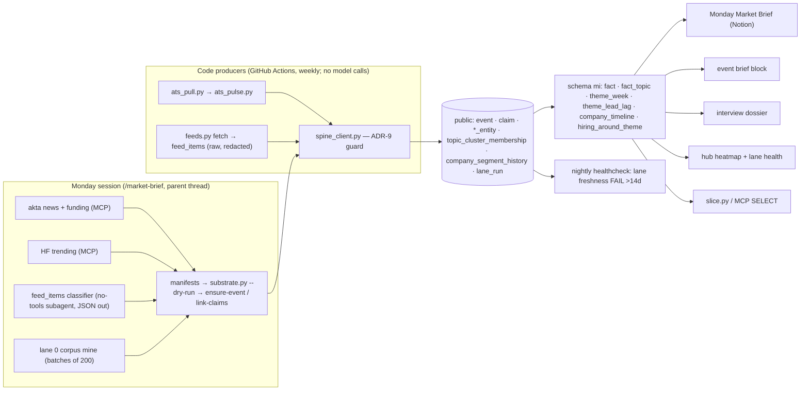

# Market Lens + Slice Layer — design proposal

**For:** Alex · **Date:** 2026-11-04 · **Status:** proposal, nothing built · **Replaces:** §7 of `docs/proposals/2026-11-03-dynamic-topic-taxonomy.md` (PR #267)
**Evidence:** repo files cited inline; prod inventory as read 2026-11-04 (attended 84 · `role_posted` 183, last 2026-09-23 · market 31 · launch 9 · funding 3 · exec_move 1 · claims: 3,520 `web_verified`, 1,384 `first_hand`, 796 `notion_prior`, 23 `email_signal`; 22% entity-unlinked · topics 272, 30 clusters). No Supabase data touched.
**Confidence:** 75% that this shape is right (high on the data model and the kill rules, which follow directly from why the old lanes died; lower on akta credit economics, which need a live `account_status()` read before the pilot number is set).

## 0. The short version

The graph already holds two views of the world and reports one. The attended lens (84 events, 1,384 first-hand claims) is Alex's rooms. The research lens (3,520 web-verified claims extracted from 36 research briefs, asserted 2012–2026) is the wider market as seen through the companies and speakers those rooms brought in, and today nothing counts it, slices it or links it to a theme. A market lens proper (news, funding, hiring, papers) has been attempted three times and died three times, for one reason: a producer with no schedule and no weekly reader.

This design does three things. It defines a **slice contract**, the dimensions every fact must carry so any cut (lens × theme × segment × time) is valid and comparable, implemented as a Kimball-style conformed-dimension layer in a new `mi` schema. It stands up **six ingestion lanes**, starting with lane 0, mining the corpus already paid for, and each lane is born with a schedule, a consumer and a kill rule. And it ships one **consumer that keeps the lanes alive**: a Monday Market Brief that also feeds the event brief, the interview dossier, the Upcoming Week roundup and the hub.

The bold part is scope: every lane, the full semantic layer, lead/lag analytics, cohorts. The guardrails are unchanged: one write path (`spine_client`), no PII, DDL by Alex after a twin rehearsal, null baselines on every number, nothing public without his go.

## 0.5 Lessons from what already failed — read before building

Every item below happened in this graph and is evidenced in git, Linear or prod. Each one maps to a rule this design enforces.

| # | What failed | Evidence | The lesson → the rule here |
|---|---|---|---|
| L1 | **Inbox miner** (ADR-7): 1 run, 13 rows, retired 2026-09-28 (ADR-11) | ADR-11 usage table | A permanent manual gate plus a cron that never got enabled means the lane never runs. **Every lane ships scheduled, with a freshness alarm** (§2). |
| L2 | **`trend_radar`** (HN / HF / newsletters): 24 market rows, 6 Aug to 8 Sept, then pruned | prod `event.source`; 9/28 prune sweep | Nothing read its output every week, so it was cut as friction. **No lane without a named weekly consumer**; the Monday brief is that consumer (§5). |
| L3 | **`morning_refresh`**: 7 rows, one day | prod `event.source` | Manual triggering decays within days. **A run ledger (`lane_run`) plus kill rules**, so a dead lane is visible and gets retired on purpose, not by neglect. |
| L4 | **Cluster assignment was a one-time bootstrap**; 94 topics went unassigned from 8 Aug and nothing noticed | YED-304 | One-off setup steps silently become permanent gaps. **Every derived dimension needs a recurring producer and a coverage alarm**, not a backfill. |
| L5 | **The "second pass" that never ran**: the YED-171 backfill skipped id-only topics, so 3 events never got their topics | YED-304 W4 | A deferred follow-up with no owner and no alarm doesn't happen. **No "re-run later"; deferrals become Linear issues with an owner, or an alarm.** |
| L6 | **The health check stayed green for weeks** while 37% of topics fell outside every trend | `topic_intelligence_health.canonicalization_backlog` tripping at 102, unread by `healthcheck_2b.py` | Correctness checks don't prove completeness. **Every lane and view carries a coverage metric beside its parity check** (§3, §7). |
| L7 | **A compute function stranded by a schema move**: after the 2B swap the nightly recompute referenced dropped tables, and the stored trends froze at as_of 2026-08-10 (the nightly went red from 09-19 until 0012 repointed it) | migration 0012 header (YED-230) | A migration that moves tables can orphan their producers. **The 0016 rehearsal must run the full nightly chain on the twin, not only the DDL.** |
| L8 | **Two parallel spines** (gtm-os `signal.*` and Empire) drifted and needed a consolidation project | YED-130, ADR-0 | **One graph, one producer path** (`substrate.py` → `spine_client`). Market lanes do not get their own store. |
| L9 | **Contact PII leaked through a legacy column and a rollback copy**: `person.email`, then `pre2b.person.email` | S-04, YED-296 | Every new table is a new place PII can land. **New `mi` tables go through the YED-297 nightly column audit and the ADR-9 guard with negative selftests.** |
| L10 | **The job-postings lane stalled on 2026-09-23** (183 `role_posted`, none since) and nothing alerted | prod `event` | Even a lane that works dies quietly without an alarm. **Lane 1 starts by fixing this, with a freshness FAIL at 14 days.** |
| L11 | **A ship rule passed on 6% coverage**: the W2 kNN "PASS" came from 10 near-duplicate names | #266 evidence | A precision gate without a coverage floor lets a useless method pass. **Every gate here sets precision and coverage floors, plus a null baseline.** |
| L12 | **22% of claims are linked to no entity**, so the corpus is invisible to any slice | S-01 | Data that can't be joined doesn't count. **Lane 0 (link the existing corpus to ≥95%) comes before any new ingestion.** |

## 1. Thesis and success definition

**The insight Alex cannot get today is the comparison.** An attended count says where his rooms are; a market count says where the ecosystem is; the gap between them is the thing worth knowing before a panel, a post or an interview. Eight questions the layer answers, each tied to a pipeline stage:

| # | Question | Slice | Feeds |
|---|---|---|---|
| Q1 | Is my room ahead of or behind the market on theme X? (lead/lag in weeks) | theme × lens × week, first-seen per lens | event brief, content POV |
| Q2 | Who is hiring around a rising theme, and are they in my rooms? | theme → companies (market) ⋈ hiring pulse ⋈ attended presence | interview prep, outreach |
| Q3 | Which themes does the market fund that my rooms ignore? | funding facts by theme vs attended tags by theme, 90 days | event selection, roundup |
| Q4 | What has company Y done in the last 90 days, and what did I hear about it first-hand? | company × lens timeline | interview dossier, connection notes |
| Q5 | Which of my target companies are heating up (funding, hiring, launches) this quarter? | target-flag cohort × market facts × week | `/scan-roles` priority, outreach timing |
| Q6 | Which NYC companies first appeared this quarter, in which themes? | company cohort by first-seen quarter × lens | roundup, research triage |
| Q7 | Where does the research frontier (papers, model releases) sit relative to what speakers claim? | HF facts by theme vs first-hand claims by theme | Deep Read, questions |
| Q8 | What did the research briefs establish about theme X that no event has said out loud? | research-lens claims by theme with zero attended corroboration | questions to ask, content |

**Success in 90 days.** Four Monday briefs in a row with at least one item Alex uses (logged as `claim_usage`, consumer `content`, `event` or `job`); the research corpus at ≥95% entity-linked (S-01's target; 78% today); lead/lag computed for ≥20 of 30 themes above the `insufficient_data` floor; and no lane older than 14 days. Null baseline for "used": zero, which is what every prior market lane achieved.

## 2. Sources and ingestion lanes

Every lane has the same six parts, which is the reason it will not die the way `inbox_miner`, `trend_radar` and `morning_refresh` did: a scheduled producer, one write path, a lane ledger row per run, a freshness alarm, a named consumer, and a kill rule.

| Lane | Source | Yields | Cadence · runner | Cost | Producer path | Tier | Consumer |
|---|---|---|---|---|---|---|---|
| **0 Corpus mine** | the 3,520 `web_verified` + 796 `notion_prior` claims already in `claim` | `claim_entity` topic/company links; theme via topic; `claim_relation corroborates` to first-hand claims | one backfill (~18 batches of 200) then per research brief at `stage-research` | subscription | `resolve_claim_entities.py --apply` (exact-name pass, exists) then `substrate.py link-claims --manifest` (new verb; session-proposed links, dry-run first) | unchanged (`web_verified`) | Q1, Q3, Q8; the research-lens column of every slice |
| **1 Hiring pulse** | ATS boards already in `target-companies.md` registry via `ats_pull.py` (code, zero tokens) | one `market` event per company per week: `signal_type='hiring_pulse'`, metadata `{roles_open, gtm_roles, ai_gtm_roles, delta_wow}`. Counts only, never titles or people | weekly GitHub Action (Sunday) | free | `ats_pull.py` → new `ats_pulse.py` → `substrate.py ensure-event` | `web_verified` (public board) | Q2, Q5. Separate from the job lens: `role_posted` stays Alex's approved pipeline, keyed by Notion page id; the pulse is an aggregate about the market |
| **2 Company signals** | akta.pro `news_signals(company=…)` + `company_data(funding_detail)` for the watchlist | `funding` / `launch` / `exec_move` / `market` events with URL, one claim per article summary | weekly, in the Monday session (MCP lives in-session) | **credits** — pilot 40 companies × 1 call/week; cap set from `account_status()` before run 1; **Alex's go** | parent writes a manifest → `substrate.py ensure-event` (company + topic edges; no person rows in Phase A) | `web_verified` | Q2–Q6 |
| **3 Research frontier** | Hugging Face `hf://papers/trending`, `models/trending` | `market` events, `signal_type='paper' \| 'model_release'`, tagged to themes | weekly, Monday session | free | same manifest path | `web_verified` | Q7, Deep Read |
| **4 Feeds** | company blogs, changelogs, YouTube via `feeds.py` (S-02; code half built) | raw `feed_items` (staging), then classified `launch`/`market` events | weekly GitHub Action fetches and stores raw; Monday session classifies | free | Action writes `feed_items` through `spine_client`; session writes events via `ensure-event`. **The Action never calls a model** | `web_verified` | Q4, Q6 |
| **5 Segment enrichment** | Apollo `organizations/enrich?domain=` (free, verified working) then akta `firmographic` where Apollo is thin | company segment: stage, industry, headcount band, HQ | once per company on first sight, refresh quarterly | free then credits | `substrate.py ensure-entity` (company) + `company_segment_history` row | `web_verified` | the segment dimension of every slice |
| **6 Theme sweep** (optional) | WebSearch, 5 most active themes | research-lens claims tagged to the theme | monthly, in-session | subscription (counts against the 200/session cap) | `stage-research` with a synthetic `theme:` manifest | `web_verified` | Q1, Q8 |

Lane 0 is the one that changes the picture immediately: it turns a dormant corpus into the research-lens column for 30 themes with zero spend and zero new data. Lane 1 fixes a stall (`role_posted` has had nothing since 2026-09-23) and adds a market-grade hiring signal that needs no per-role approval, because it writes counts, not roles. Lanes 2 and 5 are the only ones with credits, and both start as a 40-company pilot.

**Watchlist.** The companies lanes 2, 4 and 5 follow: the target list (private; flagged in the DB as `company.metadata.target_tier`, never rendered on a public hub page) plus the top 100 companies by `relevance_score` among those linked to an attended event. About 150 rows; the pilot runs the first 40 by relevance.

## 3. Data hygiene: the slice contract

**The point:** a slice is only honest if every fact it counts carries the same dimensions with the same meanings. This is Kimball's conformed-dimension rule (*The Data Warehouse Toolkit*, 1996): one `company`, one `topic`/`theme`, one `time`, one `lens`, shared by every fact table, so any two cuts can be laid side by side.

### 3.1 The fact and its dimensions

A fact is an `event` row or a `claim` row, surfaced through one view, `mi.fact`:

| Dimension | Source of truth | Rule |
|---|---|---|
| `lens` ∈ attended · research · market · job | **derived**, never stored: `mi.lens_of(kind, source, lane)`. attended = `kind='attended'`; job = `role_posted/application/interview`; research = claims with `lane='research'` or source `substrate:research`; market = everything else external | one function, one place; no column to drift (connascence of algorithm kept local) |
| `kind` | `event.kind` (existing check constraint) | market lanes use existing kinds; no new kind for Phase A |
| `signal_type` | new nullable `event.signal_type` (hiring_pulse · paper · model_release · news · partnership · layoff) | finer than `kind`, coarser than `metadata`; a dimension, so a column, not JSON |
| `source_system` · `source_ref` | `event.source` prefix (`akta`, `hf`, `ats_pulse`, `feeds`, `substrate:*`) · `event.url` / claim locator | URL is the dedup key for market facts (ADR-7's one surviving rule) |
| `provenance_tier` | `claim.provenance_tier`; events inherit from the lane | existing six-value check |
| `asserted_at` vs `observed_at` | `event_date` / `claim.asserted_at` (when it was true) vs `created_at` (when we learned it) | slices bucket on `asserted_at`; briefs print both; a 2024 funding round ingested today is not "this week's news" |
| entity links | `event_entity` / `claim_entity` | market facts carry ≥1 company or topic edge or they are refused (`ensure-event` already requires entities) |
| `topic_id` → `theme_id` | `topic.cluster_id` today; **`topic_cluster_membership(topic_id, cluster_id, valid_from, valid_to)`** from migration 0016 | theme is resolved **as of the fact's `asserted_at`**, Type 2 slowly changing dimension (Kimball). This is the precondition PR #267 §9 names before any trend history persists; this design supplies it |
| company segment | `company_segment_history(company_id, stage, industry, headcount_band, hq_metro, target_tier, valid_from, valid_to, source)` | Type 2 as well: a company that raises a Series B in October is "seed" for September facts |

### 3.2 Normalization, dedup and entity resolution

- **Companies:** the existing `lower(name)` unique index plus the YED-47 qualifier tier; market lanes add `website` host on every row so `resolve_company_tier` has two keys, not one. Unresolved → created and surfaced to `identity-ambiguity.jsonl`, never guessed (ADR-4 D3). Ten ambiguities in 30 days re-triggers the S1b `entity_alias` DDL, which this volume will probably do; that is a feature of measuring, not a problem.
- **Market events:** dedup key = canonical URL + `kind`. Secondary: `(company_id, kind, week_bucket)` flags a probable duplicate across lanes (akta and a feed reporting the same round) and writes `claim_relation corroborates` rather than a second count.
- **Topics from market text:** market lanes may **link to existing topics only** in Phase A. A concept with no topic lands on the theme's `(general)` topic (PR #267 rule). New topic births from market text are quarantined: created with `metadata.lens_origin='market'`, excluded from the attended board and from theme proposals until corroborated by a second source or one attended tag.
- **People:** no person rows from market lanes in Phase A (ADR-7 R2, kept). Exec moves carry the name in the event title only.

### 3.3 The rules that keep slices honest

1. **Never sum across lenses.** An attended tag is an occasion Alex witnessed; a market fact is a published signal; a research claim is a sentence a researcher verified. `mi.theme_week` returns one row per (theme, lens, week); there is no "total" column, by construction.
2. **Denominators per lens.** attended: events in window. research: briefs (documents) in window. market: facts ingested per source in window **and** watchlist coverage (companies with ≥1 fact ÷ watchlist). job: boards scanned. Every rate in a brief names its denominator.
3. **Floors before labels.** A theme × lens cell below 3 facts in 8 weeks is `insufficient_data`, the same floor 0012 uses; lead/lag is shown only when both lenses clear it.
4. **Coverage metric beside every correctness metric** (the YED-304 lesson): per lens, per week, `lane_run` records items seen, written, refused and credits spent; a lane with `items_written=0` for two runs is a FLAG, three is a FAIL.

## 4. Slice and cohort layer

**The point:** Alex explores in three places, all reading the same views, so a number on the hub is the number in the session.

**Query model: a semantic layer in SQL views, not a cube product.** The idea is the OLAP cube (Codd, 1993) and the modern semantic layer (LookML, dbt metrics, Cube.dev): define measures and dimensions once, let every consumer query them. At this volume (thousands of facts) Postgres views are the whole engine; nothing to host.

| View / function (schema `mi`, read-only) | Grain | Answers |
|---|---|---|
| `mi.fact` | one row per event or claim with all §3.1 dimensions | the base of everything |
| `mi.fact_topic` | fact × topic × theme-as-of-asserted_at | theme slices |
| `mi.theme_week` | theme × lens × ISO week: facts, distinct companies, distinct sources, floor flag | Q1, Q3, Q7; the hub heatmap |
| `mi.theme_lead_lag` | theme: first-seen per lens, 8-week rolling counts per lens, lead weeks (market first-seen minus attended first-seen) | Q1 |
| `mi.company_timeline` | company × lens × week | Q4, Q5 |
| `mi.company_cohort` | company: first-seen quarter per lens, segment as-of, target flag | Q5, Q6 |
| `mi.hiring_around_theme` | theme → companies with market facts in 8 weeks ⋈ latest hiring pulse ⋈ attended presence (events, speakers) | Q2 |
| `public.mi_slice(view, filters jsonb)` | security-definer reader, service role only (0011/0012 pattern); `mi` stays unexposed to PostgREST | the one door |

**Canonical slices** live in the repo as named SQL in `.claude/references/slices.md` (reviewable, versioned): `attended_vs_market_by_theme_8w`, `funded_not_attended_90d`, `target_companies_heating_qtd`, `new_nyc_companies_by_quarter`, `research_without_room_corroboration`, `frontier_vs_room`. **Cohorts** are saved predicates in the same file, not a table, until a surface needs them persisted: *first seen Q3 2026 (any lens)*, *themes where market first-seen precedes attended by ≥4 weeks*, *seed-to-A companies in agentic infrastructure*, *target tier A/B*.

**Three explorers.** (1) `slice.py` (`.claude/scripts/`, stdlib, REST reads only): `slice.py run <name> [--since] [--lens]` prints a table and the denominators; `slice.py adhoc --sql-ref <file>` for one-offs. (2) In-session: `alex:cto-principal-architect` or `Explore` reads via the Supabase MCP SELECT path, which is already read-only. (3) The hub `/ops/market-intel` reads `mi.theme_week` and `mi.theme_lead_lag` for a theme × lens heatmap and a lead/lag strip, replacing the attended-only trend table.

**Comparison views** always render the lenses as adjacent columns with their own denominators, never a ratio of one to the other unless both clear the floor; the lead/lag number carries its permutation-null band (§7).

## 5. Surfaces: the consumers that keep lanes alive

| Surface | What it shows | Lanes it consumes | Cadence |
|---|---|---|---|
| **Monday Market Brief** (new `/market-brief` command; one Notion page per week under the Hub parent; a `documents` row, `source_type='scan_digest'`) | theme movers per lens side by side; lead/lag table; hiring around the top 3 rising themes; target companies heating; new companies; research claims with no room corroboration; a **lane health strip** (freshness, items, credits) | 0–6, all | Monday, in-session; the queue runs it under "proceed without prompting" because it writes only a Notion draft and graph rows |
| Event brief (`/event-deep-research` Step 1.7a block) | per event theme: attended vs market 8-week counts, 3 cited market facts, the lead/lag line | 0, 2, 3, 4 | per event |
| Interview dossier (`interview-prep-dossier`) | company timeline (funding, launches, hiring pulse, news) with the themes the company is active in vs Alex's rooms; Q2 and Q4 | 1, 2, 4, 5 | per interview |
| Upcoming Week roundup | "what the market did this week" paragraph, sides not taken | brief | weekly |
| Content ideation / steering | `funded_not_attended_90d`, `research_without_room_corroboration` as prompts | 0, 2 | per steering |
| Hub `/ops/market-intel` | heatmap + lead/lag strip + lane health | views | nightly |

A note on PR #267's "no Monday review" decision: that ruled out a review ritual for theme assignments, and this does not reinstate one. The brief is a thing Alex reads, not a queue he works; assignments still surface in the post-event run summary. The tension is real and named in §9 so he can rule on it.

## 6. Architecture and phasing

**Phase A — most insight per unit of risk (about 3 weeks of sessions, zero credits).**
1. **ADR-13 + migration 0016 `mi_semantic_layer`:** `topic_cluster_membership` (seeded from today's `topic.cluster_id`, `valid_from = cluster_assigned_at or 2026-08-08`), `company_segment_history`, `lane_run`, `event.signal_type`, the `mi` views, `public.mi_slice`. Additive only; rollback drops only what it adds. Rehearsed on the twin (`ytfzzsxcxxbejnowmkmk`) by a `rehearse_0016.py` in the `rehearse_s1a.py` shape: planted fault the verify must catch, rollback to an identical schema fingerprint. Then Alex pastes into prod. `spine_client.ALLOW` gains three table rows; that is a guard diff, so human review plus `--selftest` (with negative cases: an email in `feed_items.summary` must hard-fail) and `--check-writers`.
2. **Lane 0** backfill: exact-name pass, then session batches, each a dry-run table before `--apply`. Target ≥95% linked.
3. **Lane 1** `ats_pulse.py` + Action; **Lane 3** HF in the brief.
4. **`slice.py`** and `slices.md` with the six canonical slices.
5. **Monday Market Brief v1** (lanes 0, 1, 3). First brief is the Phase A acceptance test.

**Phase B — the market proper (weeks 4–8, credits with Alex's go).** Lane 2 pilot (40 companies, 30 days, hard credit cap in the command), lane 5 segments (Apollo free first), `theme_lead_lag` with the permutation band, event-brief and dossier blocks, hub heatmap.

**Phase C — breadth (weeks 9+, on evidence).** Lane 4 feeds (`feed_sources`/`feed_items` DDL as migration 0017; S-02's "waits for ADR-12" is stale, ADR-12 is now the job-search ADR), watchlist to 150, lane 6, persisted cohorts if a surface needs them, person edges from market if Alex rules yes.

**Who builds what.** Claude Code (in-session, prod-adjacent): ADR-13, migration 0016 and its rehearsal, every `substrate.py`/`spine_client.py` change, lane 0 batches, the Monday brief command, MCP lanes, the slices file. Obvious (twin only, no prod credentials, one PR per item, Claude reviews, Alex merges, per S-04 rules): `ats_pulse.py` + Action, `feeds.py` fetch Action, the feed classifier's JSON schema and selftest, `slice.py` rendering, the hub heatmap component, `lane_run` fixtures for the healthcheck.

## 7. Evaluation

| Measure | Null baseline | Floor / decision |
|---|---|---|
| Lane 0 link rate | `resolve_claim_entities.py` dry-run today (exact-name only) | ≥95% linked; below 90% after the backfill → the claim extractor's `proposed_entities` is the problem, fix upstream |
| Lead/lag per theme | shuffle lens labels across facts 200×; report the observed lead against the null band | show only when outside the 90% band **and** both lenses clear the 3-fact floor; otherwise "no information" |
| Brief usefulness | 0 used items/week (every prior lane's record) | ≥1 `claim_usage` row per brief for 4 consecutive weeks → Phase B; 0 for 4 weeks → stop the lane that contributed nothing, decision issue |
| Market coverage of the watchlist | 0 | ≥60% of pilot companies with ≥1 fact in 90 days, else widen sources before widening the list |
| akta cost per cited item | credits ÷ items Alex used | review at 30 days; over the cap Alex set → pause, never silently continue |
| Lane freshness | `trend_radar`: 33 days of life | FLAG at 7 days stale, FAIL at 14, in `healthcheck_2b.py` layer 6 |
| Taxonomy pollution | 0 market-born topics on the attended board | any such row is a defect |

Decision points: after brief 4 (Phase A go/no-go), 30 days into akta (credits), 90 days (expand or stop each lane individually).

## 8. Risks and invariants (FMEA, Klein pre-mortem framing)

| Failure mode | Effect | S | O | D | RPN | Mitigation | Residual |
|---|---|---|---|---|---|---|---|
| Press contact emails or phones in feed/news text reach the spine | ADR-9 breach | 9 | 5 | 3 | 135 | `redact_body()` before write **and** the guard hard-fails; both tested alone (privacy-layer rule); no person rows from market lanes | 9·2·1 = 18 |
| Prompt injection in scraped text steers a writer | wrong or hostile rows, public copy downstream | 8 | 4 | 6 | 192 | Actions store raw text with no model in the loop; classification runs in a **no-tools subagent returning JSON**; the parent validates with `--dry-run` and writes schema-checked manifests; market facts never bypass `output-evaluator` on the way to copy | 8·2·2 = 32 |
| Credit runaway | spend without consent | 6 | 4 | 4 | 96 | per-lane weekly cap in the command, `lane_run.credits` logged, hard stop at cap, confirmation line before every metered call | 6·1·2 = 12 |
| Taxonomy pollution from market topics | attended trends diluted, false themes proposed | 7 | 6 | 5 | 210 | link-to-existing only; quarantine flag; corroboration rule before promotion; attended board filters `lens_origin` | 7·2·2 = 28 |
| Lane dies quietly (the historical killer) | stale brief, trust lost | 7 | 7 | 8 | 392 | schedule + ledger + freshness FAIL + consumer + kill rule, all mandatory per lane | 7·3·2 = 42 |
| Double counting across lanes | inflated market counts | 5 | 6 | 6 | 180 | canonical-URL key; `(company, kind, week)` corroboration link, not a second row | 5·2·3 = 30 |
| Two writers on one event | contradictory records | 8 | 2 | 4 | 64 | market lanes never edit attended rows; the Monday run takes `event-claim.py claim "market-brief:<ISO week>"`; per-market-event idempotent upsert on URL | 8·1·2 = 16 |
| Stale facts read as fresh | wrong POV in copy | 6 | 5 | 5 | 150 | `asserted_at` and `observed_at` both carried and printed; slices bucket on `asserted_at` | 6·2·2 = 24 |
| Membership history wrong after a topic merge | silent delta corruption | 7 | 4 | 7 | 196 | `substrate.py merge` writes a `topic_cluster_membership` close/open pair; healthcheck asserts every live topic has exactly one open membership | 7·2·2 = 28 |

Invariants restated for this build: writes only via `spine_client` (no MCP DML, no curl); Supabase MCP read-only; DDL by Alex after the twin; one writer per event; public repos, private inputs (the target list stays gitignored; its flag lives in the DB and never on a public hub page); HubSpot untouched by any lane.

## 9. Decisions for Alex (five, each with a recommendation)

> **Decided (Alex, 2026-11-04): all five as recommended.** (1) ADR-13 + migration 0016 as one additive migration; (2) akta pilot with a cap read from `account_status()`, and no spend before Alex has seen the number; (3) the Monday Market Brief is the standing consumer; (4) no person edges from market lanes in Phase A; (5) market-born topics are quarantined until corroborated. Recorded in Linear as a `decision` issue.

1. **ADR-13 + migration 0016 as one additive migration** (membership SCD2, segment history, lane ledger, `signal_type`, `mi` views). *Recommend yes.* It is the precondition PR #267 already named; splitting it buys nothing.
2. **akta pilot: 40 watchlist companies, weekly, 30 days, with a credit cap read from `account_status()` before run 1.** *Recommend yes with the cap; no spend before the number is on the table.* Alternative: Apollo-only (free, firmographics but no news), which answers Q5 and not Q2–Q4.
3. **The Monday Market Brief as the standing consumer**, alongside the "no Monday review" ruling for theme assignments. *Recommend yes:* a brief to read is not a queue to work, and it is the single mechanism that kept no earlier lane alive because none had it.
4. **Person edges from market lanes (exec moves, paper authors).** *Recommend no in Phase A*; companies and topics only, revisit at the 90-day point with the identity-ambiguity ledger in hand.
5. **Market-born topics: quarantine until corroborated (recommended) vs. allow in-session birth with the same `(general)` rule as attended.** *Recommend quarantine:* the attended taxonomy is Alex's curation; market text at 10× the volume would otherwise redefine it in a month.

---

## Teaching layer

**What / why.** This is a dimensional-modelling design: one fact grain, conformed dimensions, slowly changing history where meaning moves over time (theme membership, company stage), and a semantic layer of views so every consumer reads the same numbers. The decision rule throughout was "a lane earns its place by having a schedule, a reader and a kill rule"; that rule is the autopsy of the three dead lanes turned into a build requirement.

**Key concepts (3).**
- *Conformed dimensions and the bus matrix* (Ralph Kimball, *The Data Warehouse Toolkit*): shared dimension tables let facts from different processes be compared without re-interpretation. Here: lens, theme, company segment, time.
- *Slowly changing dimensions, Type 2* (Kimball): keep every historical version with `valid_from/valid_to` so a fact is attributed to the theme or stage that was true when it happened, not today's. Here: `topic_cluster_membership`, `company_segment_history`.
- *Semantic layer / OLAP cube* (E. F. Codd's OLAP paper, 1993; LookML and dbt metrics as modern forms): define measures and dimensions once, query many ways. Here: schema `mi`, one reader function, `slice.py`.

**Trade-offs in plain language.** Views over a cube product: nothing to host, but every heavy query recomputes (fine at thousands of rows; revisit at millions). Derived lens over a stored lens column: no drift, slightly slower queries. Quarantining market topics: the attended taxonomy stays Alex's, at the cost of market concepts taking a week or two longer to appear as their own topics. Credits: akta buys news coverage no free source gives; the pilot is sized so a bad month costs a known number.

**What changed.** One file written: `/Users/sameoldexpressions/Documents/GitHub/Empire_State_Events_Pipeline_Take_3/docs/proposals/2026-11-04-market-lens-and-slices.md`. Nothing built, no data touched.

**Interview framing.** "I designed a market-intelligence layer as a small Kimball warehouse on Postgres: conformed lens, theme and segment dimensions with Type 2 history, a semantic layer of views, and ingestion lanes that each ship with a schedule, a consumer and a kill rule, because the lanes we lost before died of having none of those."
